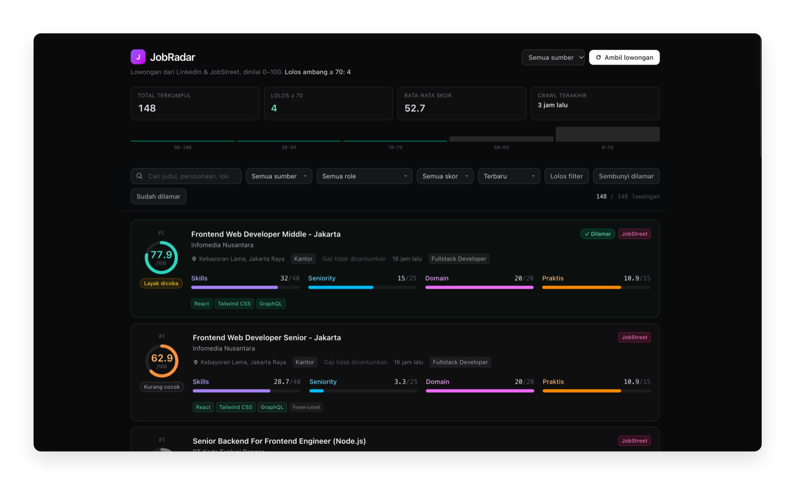

<div align="center">

# JobRadar

**Lowongan dari LinkedIn & JobStreet, dinilai 0–100 terhadap profil kamu,
lolos ambang ≥ 70 saja yang ditampilkan.**

[](https://nextjs.org)
[](https://react.dev)
[](https://typescriptlang.org)
[](https://bun.sh)
[](https://tailwindcss.com)

</div>



---

## Masalahnya

Buka LinkedIn, ketik "frontend developer", dapat 300 lowongan dalam 10 menit.
Baca 30, sudah capek. Sisanya 270 tidak pernah dibuka — dan 200 di antaranya
memang tidak relevan.

JobRadar menyaring itu lebih dulu:

1. **Crawl** lowongan dari LinkedIn & JobStreet (sopan: jeda 2.5–6 detik, cache 12 jam).
2. **Gate** — judul di luar `role_families` dibuang sebelum dinilai.
3. **Nilai** setiap lowongan 0–100 dari empat komponen.
4. **Tampilkan** hanya yang ≥ 70, lengkap dengan rincian kenapa skornya segitu.

Dari 148 lowongan pada tangkapan layar di atas, **4 yang lolos**.

## Empat komponen penilaian

| Komponen | Bobot | Kenapa |
|---|---|---|
| **Skills Overlap** | 40 | Yang pertama dicek hiring manager |
| **Seniority Fit** | 25 | Menjaga kamu dari lowongan yang menolak di baris pertama |
| **Domain Fit** | 20 | Judul sama di industri berbeda bukan pekerjaan yang sama |
| **Practical Fit** | 15 | Lokasi, remote, gaji — hal yang membunuh tawaran setelah empat interview |

**Bobot dinamis saat data hilang.** Kalau lowongan tidak mencantumkan gaji atau
industri, komponen itu ditandai *"tidak dinilai"* dan bobotnya dialihkan ke
komponen lain — bukan dihitung sebagai nilai buruk.

> Bandingkan lowongan #1 dan #2 di tangkapan layar. Keduanya punya domain fit
> penuh, tapi #1 lolos karena skills overlap 32/40, sedangkan #2 gagal karena
> seniority cuma 3.3/25 — bobot yang tersisa setelah komponen tanpa bukti
> dikeluarkan dari pembagi.

Detail algoritma: [`lib/scoring/`](lib/scoring) ·
Uji mandiri: `bun run test:scoring` (47 kasus)

## Stack

| Lapisan | Pilihan | Alasan |
|---|---|---|
| Web | Next.js 15 App Router + React 19 | Server component untuk baca DB langsung, tanpa API lapis |
| Style | Tailwind CSS 4 | Tanpa config file, cukup satu `@import` |
| Data | `node:sqlite` / `bun:sqlite` | Tanpa native binding, tanpa migration framework |
| Runtime | Bun | Dipakai untuk CLI & crawler, web tetap jalan di Node |
| Config | `profile.yaml` | Semua preferensi kandidat di satu file yang dibaca manusia |

Tidak ada ORM, tidak ada state manager, tidak ada auth — total dependensi
produksi cuma 4: `next`, `react`, `react-dom`, `yaml`.

## Mulai cepat

```bash
git clone https://github.com/<user>/jobradar.git
cd jobradar
bun install

# 1. Sesuaikan profilmu (wajib — ini yang dinilai)
$EDITOR profile.yaml

# 2. Uji mesin penilaian tanpa crawl
bun run test:scoring

# 3. Ambil lowongan (butuh ±15–25 menit untuk 12 query)
bun run crawl

# 4. Jalankan web
bun run dev        # http://localhost:3000
```

### Prasyarat

- [Bun](https://bun.sh) ≥ 1.1 (atau Node ≥ 22.5 untuk `node:sqlite`)
- SQLite aktif (bawaan, tidak perlu install)

## Konfigurasi — `profile.yaml`

Ini bobot terbesar pengalaman. **Seluruh penilaian dihitung dari file ini;
kode tidak perlu disentuh.**

| Kunci | Pakai untuk |
|---|---|
| `candidate.skills` | Dikelompokkan `core` (1.00) → `strong` (0.85) → `working` (0.70) → `familiar` (0.50). Nama harus ada di [`lib/skills-dictionary.ts`](lib/skills-dictionary.ts) |
| `candidate.role_families` | **Gate.** Judul di luar daftar ini dibuang sebelum dinilai |
| `candidate.seniority` | Level target, level yang dipildai, bobot per level |
| `candidate.domains` | Industri yang pernah kamu kerjakan |
| `candidate.location` | Area prioritas (skor penuh) vs yang masih bisa dijangkau (skor sebagian) |
| `candidate.salary` | Batas keras, target bulanan, batas atas |
| `scoring.threshold` | Ambang tampil, default `70` |
| `crawl.queries` | Query + lokasi yang dikirim ke tiap sumber |

## Perintah

| Perintah | Fungsi |
|---|---|
| `bun run dev` | Web development di `:3000` |
| `bun run build` / `bun start` | Build & jalankan produksi |
| `bun run crawl` | Crawl penuh → database |
| `bun run crawl --dry-run --limit 2` | Uji 2 query pertama, tanpa menulis DB |
| `bun run crawl --no-cache` | Paksa ambil ulang (abaikan cache 12 jam) |
| `bun run analyze` | Distribusi skor + diagnosa kenapa lowongan ditolak |
| `bun run test:scoring` | 47 uji mesin penilaian |
| `bun run db:reset` | Kosongkan database |
| `bun run typecheck` | Cek tipe TypeScript |

### Automasi (cron)

```cron
0 7 * * *  cd /path/to/jobradar && bun run crawl >> data/crawl.log 2>&1
```

## Struktur proyek

```
app/                    Next.js App Router
  page.tsx              Dashboard — daftar lowongan, filter, sort
  jobs/[id]/page.tsx    Detail lowongan + penjelasan skor
  api/                  REST: jobs, jobs/[id], stats, crawl, applied
components/             JobCard, ScoreRing, ScoreBar, FilterBar, CrawlButton, ApplyButton
lib/
  profile.ts            Loader + validasi profile.yaml
  types.ts              Tipe bersama
  text.ts               Parse gaji, strip HTML, split seksi
  skills-dictionary.ts  Kamus skill + alias
  scoring/              Mesin penilaian: skills, seniority, domain, practical
  crawler/              http (rate limit + cache), linkedin, jobstreet, orchestrator
  db.ts / sqlite.ts     Lapisan database (node:sqlite | bun:sqlite)
  clsx.ts / ui.ts       Util kecil
scripts/
  crawl.ts              CLI crawl
  analyze.ts            Kalibrasi: distribusi skor + alasan penolakan
  test-scoring.ts       Uji mesin penilaian
  reset-db.ts           Kosongkan DB
data/                   jobs.db, cache, log — tidak di-commit
docs/preview.png        Screenshot dashboard
```

## Cara kerja scoring

```bash
bun run analyze
```

Menjalankan pipeline di atas cache lalu menampilkan:

- **Distribusi skor** dalam bucket 90–100, 80–89, 70–79, 60–69, 0–59
- **Alasan penolakan** — apakah digate role family, atau dinilai tapi di bawah ambang
- **Komponen yang paling sering kosong** — tanda `profile.yaml` masih perlu dilengkapi

Kalau banyak lowongan gagal di bucket yang sama, itu bukan bug crawler;
itu profil yang belum lengkap.

## Catatan legal

Scraping LinkedIn dan JobStreet **melanggar ToS** mereka. Repo ini memakai
jeda sopan, volume wajar, dan cache 12 jam untuk mengurangi beban — tapi
risiko IP diblokir tetap ada.

Untuk penggunaan production yang patuh, utamakan API resmi atau data
berlisensi. Endpoint publik bisa berubah kapan saja; kalau satu plugin
crawler mati, mekanismenya tetap jalan lewat sumber lain atau import manual.

## Lisensi

MIT — lihat [`LICENSE`](LICENSE).